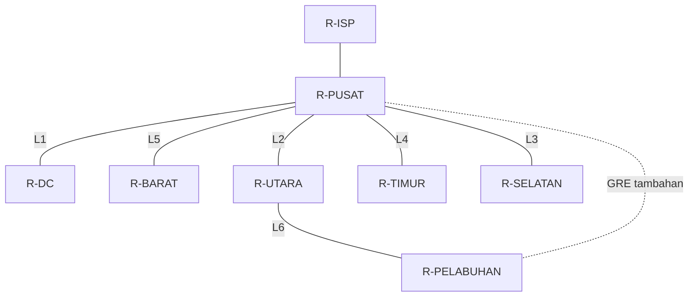

# Laporan VLSM — Smart City Surabaya, Kelompok 14

Rancangan pengalamatan IPv4 untuk jaringan Balai Kota, Command Center, empat wilayah Surabaya, dan Pelabuhan. Implementasi menggunakan Cisco Packet Tracer dengan OSPF, DHCP WiFi, serta simulasi ISP dan tunnel GRE sebagai fitur tambahan.

**Hasil pemeriksaan:** perhitungan VLSM, alamat interface, gateway, dan sambungan 14 LAN serta 6 link internal konsisten dengan PDF dan tidak tumpang tindih. Konfigurasi layanan masih memiliki catatan pada DNS dan verifikasi DHCP/GRE. **Ping, status link, dan konvergensi OSPF belum diuji langsung di Packet Tracer.**

**Petunjuk penggunaan:** bagian 1–8 menjelaskan rancangan dan hasil pemeriksaan statis. Untuk mengikuti praktik pemeriksaan, mulai dari **bagian 9.1**; setiap tahap menjelaskan lokasi, command, hasil yang benar, dan tindakan jika gagal.

## 1. Identitas, berkas, dan cakupan

- Kelompok: **14**.
- Versi: **Packet Tracer 9.0.1.0858**
- Cakupan laporan: kebutuhan host, topologi, alokasi VLSM, implementasi, efisiensi alamat, pemeriksaan, dan prosedur pengujian. Pohon serta tabel pembanding CIDR pada soal merupakan bagian terpisah dan belum disusun di laporan ini.

Jumlah host pada soal adalah **kebutuhan kapasitas**, bukan jumlah perangkat yang harus digambar satu per satu. Simulasi memakai perangkat perwakilan setiap LAN.

## 2. Blok dasar dan metode perhitungan

Aturan soal: oktet kedua = `8 × nomor kelompok = 8 × 14 = 112`. Dipilih **10.112.0.0/16**, subnet dari ruang privat `10.0.0.0/8` menurut RFC 1918. Blok ini menyediakan **65.536 alamat**, sesuai kebutuhan dan mudah dibedakan dari kelompok lain. Rentang `172.16.0.0/12` tidak dapat memakai oktet kedua 112 sebagai alamat privat.

Untuk setiap LAN, `H` menyatakan perangkat akhir sesuai soal. Satu alamat tambahan dicadangkan untuk gateway router. Pilih bit host terkecil `h` yang memenuhi:

```text
2^h − 2 ≥ H + 1
Kebutuhan alamat minimum = H + 1 gateway + 2 (network dan broadcast)
Prefix = 32 − h
Ukuran blok = 2^h
Kapasitas host valid = 2^h − 2
```

Contoh WiFi Utara: `11.000 + 1 + 2 = 11.003`; pangkat dua terdekat yang mencukupi adalah `16.384 = 2^14`, sehingga prefix `/18`. Link dua router memakai `/30`: 4 alamat dengan 2 host valid.

Alokasi dilakukan dari **ukuran blok terbesar ke terkecil**, pada batas network yang sah. Urutan subnet dengan ukuran blok sama boleh dipertukarkan; urutan di bawah mengikuti PDF. Gateway LAN menggunakan host valid pertama. Switch pada simulasi tidak diberi IP manajemen.

## 3. Topologi dan peran perangkat



`R-PUSAT` menjadi penghubung antarwilayah dan pintu keluar ke ISP. `R-UTARA` juga menjadi transit menuju Pelabuhan. Setiap router internal melayani dua LAN terpisah melalui switch masing-masing; WiFi menambahkan access point. Terdapat **7 router internal, 1 router ISP, 14 switch, 4 access point**, dan host perwakilan. Pemetaan LAN dan port tercantum pada bagian 6.

## 4. Tabel kebutuhan subnet

Kolom **Min. alamat** mencakup endpoint, gateway, network, dan broadcast. Kapasitas host valid masih mencakup alamat yang dipakai gateway.

| Subnet | Endpoint | Gateway | Min. alamat | Bit host | Prefix | Blok | Host valid | Subnet mask |
| --- | --- | --- | --- | --- | --- | --- | --- | --- |
| WiFi Publik Utara | 11.000 | 1 | 11.003 | 14 | /18 | 16.384 | 16.382 | 255.255.192.0 |
| WiFi Publik Selatan | 6.500 | 1 | 6.503 | 13 | /19 | 8.192 | 8.190 | 255.255.224.0 |
| WiFi Publik Timur | 5.500 | 1 | 5.503 | 13 | /19 | 8.192 | 8.190 | 255.255.224.0 |
| CCTV Kota | 6.000 | 1 | 6.003 | 13 | /19 | 8.192 | 8.190 | 255.255.224.0 |
| Sensor & SCADA Pelabuhan | 5.000 | 1 | 5.003 | 13 | /19 | 8.192 | 8.190 | 255.255.224.0 |
| WiFi Publik Barat | 4.500 | 1 | 4.503 | 13 | /19 | 8.192 | 8.190 | 255.255.224.0 |
| Pegawai Balai Kota | 1.800 | 1 | 1.803 | 11 | /21 | 2.048 | 2.046 | 255.255.248.0 |
| Sensor Banjir Timur | 700 | 1 | 703 | 10 | /22 | 1.024 | 1.022 | 255.255.252.0 |
| Sensor Lalu Lintas Utara | 450 | 1 | 453 | 9 | /23 | 512 | 510 | 255.255.254.0 |
| Puskesmas & Sekolah Barat | 220 | 1 | 223 | 8 | /24 | 256 | 254 | 255.255.255.0 |
| Server & Storage DC | 180 | 1 | 183 | 8 | /24 | 256 | 254 | 255.255.255.0 |
| Kantor Pelabuhan | 120 | 1 | 123 | 7 | /25 | 128 | 126 | 255.255.255.128 |
| PJU Pintar Selatan | 90 | 1 | 93 | 7 | /25 | 128 | 126 | 255.255.255.128 |
| Server Balai Kota | 20 | 1 | 23 | 5 | /27 | 32 | 30 | 255.255.255.224 |
| Link internal × 6 | 2 per link | 0 | 4 per link | 2 | /30 | 4 per link | 2 per link | 255.255.255.252 |

## 5. Tabel alokasi VLSM

### 5.1 LAN

Rentang host valid mencakup gateway; alamat network dan broadcast tidak diberikan kepada perangkat.

| LAN | Network / prefix | Rentang host valid | Broadcast | Gateway |
| --- | --- | --- | --- | --- |
| WiFi Publik Utara | 10.112.0.0/18 | 10.112.0.1–10.112.63.254 | 10.112.63.255 | 10.112.0.1 |
| WiFi Publik Selatan | 10.112.64.0/19 | 10.112.64.1–10.112.95.254 | 10.112.95.255 | 10.112.64.1 |
| WiFi Publik Timur | 10.112.96.0/19 | 10.112.96.1–10.112.127.254 | 10.112.127.255 | 10.112.96.1 |
| CCTV Kota | 10.112.128.0/19 | 10.112.128.1–10.112.159.254 | 10.112.159.255 | 10.112.128.1 |
| Sensor & SCADA Pelabuhan | 10.112.160.0/19 | 10.112.160.1–10.112.191.254 | 10.112.191.255 | 10.112.160.1 |
| WiFi Publik Barat | 10.112.192.0/19 | 10.112.192.1–10.112.223.254 | 10.112.223.255 | 10.112.192.1 |
| Pegawai Balai Kota | 10.112.224.0/21 | 10.112.224.1–10.112.231.254 | 10.112.231.255 | 10.112.224.1 |
| Sensor Banjir Timur | 10.112.232.0/22 | 10.112.232.1–10.112.235.254 | 10.112.235.255 | 10.112.232.1 |
| Sensor Lalu Lintas Utara | 10.112.236.0/23 | 10.112.236.1–10.112.237.254 | 10.112.237.255 | 10.112.236.1 |
| Puskesmas & Sekolah Barat | 10.112.238.0/24 | 10.112.238.1–10.112.238.254 | 10.112.238.255 | 10.112.238.1 |
| Server & Storage DC | 10.112.239.0/24 | 10.112.239.1–10.112.239.254 | 10.112.239.255 | 10.112.239.1 |
| Kantor Pelabuhan | 10.112.240.0/25 | 10.112.240.1–10.112.240.126 | 10.112.240.127 | 10.112.240.1 |
| PJU Pintar Selatan | 10.112.240.128/25 | 10.112.240.129–10.112.240.254 | 10.112.240.255 | 10.112.240.129 |
| Server Balai Kota | 10.112.241.0/27 | 10.112.241.1–10.112.241.30 | 10.112.241.31 | 10.112.241.1 |

### 5.2 Link fisik antar-router

Semua link berikut memakai mask `255.255.255.252`. Dua IP pada kolom ujung A/B merupakan seluruh rentang host valid subnet tersebut. Singkatan port: `Fa` = FastEthernet, `Eth` = Ethernet.

| Link | Network / prefix | Ujung A: router, port, IP | Ujung B: router, port, IP | Broadcast |
| --- | --- | --- | --- | --- |
| L1 | 10.112.241.44/30 | R-PUSAT Eth0/0/0 — 10.112.241.45 | R-DC Eth0/0/0 — 10.112.241.46 | 10.112.241.47 |
| L2 | 10.112.241.32/30 | R-PUSAT Fa0/1 — 10.112.241.33 | R-UTARA Fa0/0 — 10.112.241.34 | 10.112.241.35 |
| L3 | 10.112.241.36/30 | R-PUSAT Eth0/3/0 — 10.112.241.37 | R-SELATAN Eth0/0/0 — 10.112.241.38 | 10.112.241.39 |
| L4 | 10.112.241.40/30 | R-PUSAT Eth0/2/0 — 10.112.241.41 | R-TIMUR Eth0/0/0 — 10.112.241.42 | 10.112.241.43 |
| L5 | 10.112.241.52/30 | R-PUSAT Eth0/1/0 — 10.112.241.53 | R-BARAT Eth0/0/0 — 10.112.241.54 | 10.112.241.55 |
| L6 | 10.112.241.48/30 | R-UTARA Fa0/1 — 10.112.241.49 | R-PELABUHAN Fa0/0 — 10.112.241.50 | 10.112.241.51 |

### 5.3 Jaringan tambahan di luar blok induk

| Fungsi | Network / prefix | Host valid | Broadcast | Penggunaan |
| --- | --- | --- | --- | --- |
| GRE Pusat–Pelabuhan | 192.168.14.0/30 | 192.168.14.1–192.168.14.2 | 192.168.14.3 | Pusat `.1`, Pelabuhan `.2` |
| Pusat–ISP | 203.0.113.112/30 | 203.0.113.113–203.0.113.114 | 203.0.113.115 | ISP `.113`, Pusat `.114` |
| LAN server Internet simulasi | 8.8.8.0/24 | 8.8.8.1–8.8.8.254 | 8.8.8.255 | ISP `.1`, server `.8` |

Ketiganya **tidak dihitung** sebagai alokasi dalam `10.112.0.0/16`. Server `8.8.8.8` adalah perangkat lokal di simulasi; keberhasilan mengaksesnya tidak membuktikan akses Internet nyata.

## 6. Implementasi konfigurasi

### 6.1 Interface LAN dan host perwakilan

IP gateway dan mask setiap port mengikuti tabel bagian 4–5. Semua interface router yang digunakan memiliki `no shutdown`.

| Router | Port LAN | LAN | Host perwakilan | Alamat / metode |
| --- | --- | --- | --- | --- |
| R-UTARA | Fa1/0 | WiFi Publik Utara | Smartphone-U | DHCP melalui AP Utara |
| R-SELATAN | Fa0/1 | WiFi Publik Selatan | Smartphone-S | DHCP melalui AP-Selatan |
| R-TIMUR | Fa0/1 | WiFi Publik Timur | Smartphone-T | DHCP melalui AP-Timur |
| R-DC | Fa0/1 | CCTV Kota | PC CCTV DC | 10.112.128.2 |
| R-PELABUHAN | Fa0/1 | Sensor & SCADA Pelabuhan | PC Sensor Pel | 10.112.160.2 |
| R-BARAT | Fa0/1 | WiFi Publik Barat | Smartphone-B | DHCP melalui AP Barat |
| R-PUSAT | Fa1/0 | Pegawai Balai Kota | PC-Balai | 10.112.224.2 |
| R-TIMUR | Fa1/0 | Sensor Banjir Timur | PC-Sensor-T | 10.112.232.2 |
| R-UTARA | Fa1/1 | Sensor Lalu Lintas Utara | PC-Sensor-U | 10.112.236.2 |
| R-BARAT | Fa1/0 | Puskesmas & Sekolah Barat | PC-Puskesmas | 10.112.238.2 |
| R-DC | Fa1/0 | Server & Storage DC | Server-DC | 10.112.239.2 |
| R-PELABUHAN | Fa1/0 | Kantor Pelabuhan | PC-Kantor-Pel | 10.112.240.2 |
| R-SELATAN | Fa1/0 | PJU Pintar Selatan | PC-S | 10.112.240.130 |
| R-PUSAT | Fa1/1 | Server Balai Kota | Server-Balai | 10.112.241.2 |

Host statis menggunakan subnet mask pada tabel kebutuhan dan gateway pada tabel alokasi. DNS semua host statis diarahkan ke `8.8.8.8`.

### 6.2 Routing OSPF dan ISP

Ketujuh router internal memakai **OSPF process 1, area 0**, dengan pola berikut:

```cisco
router ospf 1
 router-id <ID dari tabel>
 passive-interface default
 no passive-interface <setiap port link internal>
 network 10.112.0.0 0.0.255.255 area 0
```

Placeholder di atas diganti sesuai tabel. Interface LAN tetap pasif: subnet LAN diiklankan, tetapi adjacency tidak dibentuk dengan host pengguna. Perintah `network` memilih interface yang ikut OSPF; perintah tersebut **tidak otomatis membuat summary route /16**.

| Router | Router ID | Port OSPF nonpasif saat ini | Jumlah tetangga fisik yang diharapkan |
| --- | --- | --- | --- |
| R-PUSAT | 14.0.0.1 | Fa0/1, Eth0/0/0, Eth0/1/0, Eth0/2/0, Eth0/3/0 | 5 |
| R-DC | 14.0.0.2 | Eth0/0/0 | 1 |
| R-BARAT | 14.0.0.3 | Eth0/0/0 | 1 |
| R-UTARA | 14.0.0.4 | Fa0/0, Fa0/1 | 2 |
| R-TIMUR | 14.0.0.5 | Eth0/0/0 | 1 |
| R-SELATAN | 14.0.0.6 | Eth0/0/0 | 1 |
| R-PELABUHAN | 14.0.0.7 | Fa0/0 | 1 |

Konfigurasi tambahan di R-PUSAT:

```cisco
ip route 0.0.0.0 0.0.0.0 203.0.113.113
router ospf 1
 default-information originate
```

R-ISP menggunakan rute balik statis:

```cisco
ip route 10.112.0.0 255.255.0.0 203.0.113.114
ip route 192.168.14.0 255.255.255.252 203.0.113.114
```

Dengan rute balik tersebut, jaringan privat dapat berkomunikasi dengan server ISP di simulasi tanpa NAT. R-ISP tidak menjalankan OSPF.

### 6.3 DHCP dan WiFi

DHCP disediakan oleh router wilayah untuk empat LAN WiFi. Alamat host pertama sampai kesembilan dikecualikan; distribusi dapat dimulai dari host ke-10. SSID dan kunci pada AP cocok dengan profil smartphone dalam berkas.

| Router / pool | SSID | Network | Gateway | Alamat yang dikecualikan |
| --- | --- | --- | --- | --- |
| R-UTARA / WIFI_UTARA | Wifi-Utara | 10.112.0.0/18 | 10.112.0.1 | 10.112.0.1–10.112.0.9 |
| R-SELATAN / WIFI_SELATAN | Wifi-Selatan | 10.112.64.0/19 | 10.112.64.1 | 10.112.64.1–10.112.64.9 |
| R-TIMUR / WIFI_TIMUR | Wifi-Timur | 10.112.96.0/19 | 10.112.96.1 | 10.112.96.1–10.112.96.9 |
| R-BARAT / WIFI_BARAT | Wifi-Barat | 10.112.192.0/19 | 10.112.192.1 | 10.112.192.1–10.112.192.9 |

Contoh konfigurasi yang tersimpan di R-UTARA:

```cisco
service dhcp
ip dhcp excluded-address 10.112.0.1 10.112.0.9
ip dhcp pool WIFI_UTARA
 network 10.112.0.0 255.255.192.0
 default-router 10.112.0.1
 dns-server 8.8.8.8
```

Smartphone diatur sebagai klien DHCP, tetapi alamat IPv4/lease belum tercatat dalam berkas. Jalankan simulasi, pastikan terhubung ke SSID wilayahnya, lalu lakukan permintaan DHCP dan periksa hasilnya.

### 6.4 Tunnel GRE tambahan

| Parameter | R-PUSAT | R-PELABUHAN |
| --- | --- | --- |
| Interface | Tunnel0 | Tunnel0 |
| IP tunnel | 192.168.14.1/30 | 192.168.14.2/30 |
| Tunnel source | Fa0/1 = 10.112.241.33 | Fa0/0 = 10.112.241.50 |
| Tunnel destination | 10.112.241.50 | 10.112.241.33 |
| Mode | gre ip | gre ip |

Jalur fisik tunnel melewati **Pusat–Utara–Pelabuhan**. Kedua router memiliki `network 192.168.14.0 0.0.0.3 area 0`, tetapi `Tunnel0` masih pasif akibat `passive-interface default`. Konfigurasi ini tidak membentuk adjacency OSPF melalui GRE; routing antar-LAN tetap dapat memakai link fisik.

Jika GRE memang dimaksudkan membawa OSPF, tambahkan pada **R-PUSAT dan R-PELABUHAN**:

```cisco
configure terminal
router ospf 1
 no passive-interface Tunnel0
end
copy running-config startup-config
```

Perubahan ini merupakan **rekomendasi**, belum diterapkan pada file asli. Aktifnya OSPF di tunnel tidak otomatis menjadikan GRE jalur utama; pemilihan rute bergantung pada cost. GRE juga tidak menyediakan jalur fisik cadangan ketika jalur transit Utara putus.

## 7. Rekap alokasi dan efisiensi

Perhitungan berikut hanya mencakup **14 LAN + 6 link fisik internal = 20 subnet**.

| Komponen | Perhitungan | Hasil |
| --- | --- | --- |
| Kebutuhan endpoint LAN sesuai soal | Jumlah seluruh H | 42.080 |
| Gateway LAN | 14 × 1 | 14 |
| IP interface link internal | 6 × 2 | 12 |
| Total kebutuhan IP perangkat menurut rancangan | 42.080 + 14 + 12 | 42.106 |
| Total blok LAN | Jumlah ukuran 14 blok LAN | 61.728 |
| Total blok link | 6 × 4 | 24 |
| Total alamat dialokasikan | 61.728 + 24 | 61.752 |
| Kapasitas blok induk /16 | 2^16 | 65.536 |
| Alokasi terhadap blok induk | 61.752 ÷ 65.536 × 100% | **94,23%** |
| Sisa belum dialokasikan | 65.536 − 61.752 | **3.784** |
| Alamat network + broadcast | 20 × 2 | 40 |
| Kapasitas host valid seluruh subnet | 61.752 − 40 | 61.712 |
| Host valid cadangan dalam subnet | 61.712 − 42.106 | **19.606** |
| Selisih alokasi terhadap kebutuhan perangkat | 61.752 − 42.106 | **19.646** |
| Efisiensi kebutuhan perangkat terhadap alokasi | 42.106 ÷ 61.752 × 100% | **68,19%** |
| Kebutuhan perangkat terhadap blok induk | 42.106 ÷ 65.536 × 100% | **64,25%** |

**94,23% adalah tingkat alokasi blok**, bukan persentase host yang benar-benar aktif. Dari selisih 19.646 alamat, 40 wajib menjadi network/broadcast dan 19.606 masih dapat dipakai sebagai cadangan host. Sisa 3.784 alamat di luar subnet berada pada **10.112.241.56–10.112.255.255**.

Jika “alamat terbuang” didefinisikan sebagai seluruh alamat blok induk yang tidak diberikan kepada perangkat sesuai kebutuhan, nilainya `65.536 − 42.106 = 23.430`, terdiri atas 3.784 belum dialokasikan, 19.606 cadangan host, dan 40 network/broadcast. Karena itu, gunakan definisi yang sama saat membandingkan dengan CIDR.

Blok tunggal terkecil yang cukup menampung alokasi VLSM internal adalah **/16**: `/17` hanya menyediakan 32.768 alamat, kurang dari 61.752. Ini juga blok paling spesifik yang mencakup seluruh rentang internal yang dialokasikan. Tunnel GRE tambahan berada di blok lain sehingga tidak termasuk klaim cakupan /16.

VLSM menyesuaikan ukuran subnet dengan kebutuhan sehingga setiap subnet memakai blok minimum yang mencukupi. Angka selisih efisiensi terhadap rancangan CIDR **belum dapat ditentukan tanpa pohon dan tabel CIDR pembanding**. Penulisan prefix `/n` dan rute balik `/16` saja belum memenuhi seluruh bagian CIDR pada soal.

## 8. Hasil pemeriksaan dan tindak lanjut

Pemeriksaan dilakukan terhadap isi konfigurasi tersimpan, parameter port, host, serta sambungan kabel di `.pkt`, lalu dicocokkan dengan PDF dan kebutuhan soal. Pemeriksaan ini tidak menjalankan mesin simulasi Packet Tracer.

| Aspek | Hasil pemeriksaan |
| --- | --- |
| Aturan Kelompok 14 dan blok privat | Sesuai: oktet kedua 112, blok 10.112.0.0/16 |
| Kapasitas, mask, batas network, rentang host, broadcast | Benar untuk seluruh 14 LAN dan 6 link internal |
| Overlap dan IP statis ganda | Tidak ditemukan pada alamat yang tersimpan |
| Interface LAN, gateway, dan host statis | Sesuai tabel; data IP port router konsisten dengan konfigurasi IOS |
| Sambungan router–router dan router–switch–host/AP | Sesuai pembagian LAN dan topologi soal |
| Penyimpanan konfigurasi | Running-config dan startup-config sama pada 8 router dan 14 switch |
| OSPF link fisik | Area, router ID, dan port nonpasif konsisten; status tetangga aktual perlu diuji |
| DHCP WiFi | Pool, gateway, dan pengecualian benar; empat klien belum menyimpan alamat IPv4 |
| DNS | **Perlu diperbaiki untuk resolusi nama:** layanan DNS Server-Internet masih Off dan database nama kosong, sedangkan klien menunjuk 8.8.8.8 |
| GRE | Endpoint konsisten; OSPF Tunnel0 masih pasif; uji tunnel diperlukan bila dipakai |
| Ping, HTTP, dan kondisi link aktual | Belum diuji langsung; belum ada bukti hasil berhasil |

**Tindak lanjut DNS:** pada `Server-Internet → Services → DNS`, ubah layanan menjadi **On** dan tambahkan A record sesuai nama yang ingin diuji, misalnya `balai.smartcity.test → 10.112.241.2`. HTTP Server-Internet sudah diaktifkan pada konfigurasi tersimpan. Akses lewat IP tidak memerlukan resolusi DNS.

Pada berkas, kabel router–switch memakai crossover. Periksa status link di simulator; bila tidak naik, pastikan port aktif dan gunakan copper straight-through yang lazim untuk router–switch. Setelah perbaikan, simpan kembali proyek. Tidak ada perubahan yang diterapkan pada `.pkt` asli dalam pemeriksaan ini.

## 9. Panduan pengecekan bertahap di Packet Tracer

Ikuti urutan 9.1–9.10. **Lanjut ke tahap berikutnya setelah kriteria lulus tahap sebelumnya terpenuhi.** Bagian GRE bersifat tambahan. Semua output contoh di bawah adalah **patokan hasil yang diharapkan**, bukan hasil pengujian yang sudah dijalankan.

### 9.1 Persiapan dan tempat mengetik command

Buka berkas `.pkt`, pilih **Realtime** di kanan bawah, dan tunggu link serta OSPF stabil. Jalankan command **di dalam Packet Tracer**, bukan CMD/PowerShell komputer pribadi.

| Perangkat / kebutuhan | Tempat menjalankan |
| --- | --- |
| Router, misalnya R-PUSAT | Klik router → tab **CLI** → tekan Enter bila diminta |
| Switch, misalnya SW-P_Pegawai-Balai | Klik switch → tab **CLI** |
| PC/server: IP, ping, tracert, nslookup | Klik PC/server → **Desktop → Command Prompt** |
| PC/server: melihat atau mengubah IP | **Desktop → IP Configuration** |
| Smartphone: SSID dan alamat IPv4 | **Config → INTERFACE → Wireless0** |
| Smartphone: gateway dan DNS | **Config → GLOBAL → Settings**, pilih Wireless0 bila ada pemilih interface |
| Access point: mencocokkan SSID/autentikasi | **Config → interface radio**, biasanya **Port 1** |
| DNS/HTTP server | Klik Server-Internet → **Services → DNS / HTTP** |
| Browser pengujian | Klik PC-Balai → **Desktop → Web Browser** |

Pada router/switch, ketik `enable` jika prompt berakhir dengan `>`. Jika sedang di `(config)#`, `(config-if)#`, atau `(config-router)#`, ketik `end` dahulu. Command `show`, `ping`, dan `traceroute` di panduan ini dijalankan saat prompt berakhir dengan **`#`**.

```cisco
enable
show ip interface brief
```

Cukup ketik isi command; jangan ikut menyalin teks prompt seperti `R-PUSAT#` atau `C:\>`. Untuk tampilan `--More--`, tekan **Space** untuk halaman berikutnya atau **q** untuk keluar. Jika ada variasi command yang ditolak oleh versi/model Packet Tracer, gunakan `?` untuk melihat pilihan yang didukung; pemeriksaan IP/mask juga dapat dilakukan melalui `show running-config`.

### 9.2 Cek link, IP, dan mask router

**Jalankan di:** tab CLI **semua router**, termasuk R-ISP, pada mode `#`.

```cisco
show ip interface brief
show running-config
```

Bandingkan IP dan mask dengan bagian 4–6. `show ip interface brief` tidak menampilkan subnet mask, sehingga mask harus diperiksa pada blok `interface` di `show running-config`.

Patokan port fisik R-PUSAT:

| Interface | IP yang harus muncul | Status / Protocol |
| --- | --- | --- |
| FastEthernet0/0 | 203.0.113.114 | up / up |
| FastEthernet0/1 | 10.112.241.33 | up / up |
| Ethernet0/0/0 | 10.112.241.45 | up / up |
| Ethernet0/1/0 | 10.112.241.53 | up / up |
| Ethernet0/2/0 | 10.112.241.41 | up / up |
| Ethernet0/3/0 | 10.112.241.37 | up / up |
| FastEthernet1/0 | 10.112.224.1 | up / up |
| FastEthernet1/1 | 10.112.241.1 | up / up |

Untuk memeriksa satu port lebih rinci, contoh **khusus R-PUSAT**:

```cisco
show interfaces FastEthernet1/0
```

| Hasil | Arti dan tindakan |
| --- | --- |
| up / up | Link dan line protocol aktif; lanjut periksa IP/mask |
| administratively down / down pada port yang dipakai | Port masih shutdown; aktifkan port tersebut |
| down / down pada port yang dipakai | Periksa kabel, port pasangan, dan daya perangkat |
| up / down | Fisik aktif tetapi line protocol belum aktif; periksa port pasangan dan konfigurasi link |
| unassigned / shutdown pada port cadangan atau Vlan1 | Sesuai bila port itu memang tidak digunakan |

Jika port yang benar masih shutdown, contoh perbaikan **R-PUSAT Fa1/0 saja**:

```cisco
configure terminal
interface FastEthernet1/0
 no shutdown
end
```

Ganti interface hanya sesuai port yang bermasalah. **Lulus tahap ini:** seluruh port yang dipakai memiliki IP/mask benar dan `up/up`; port cadangan tidak harus aktif.

### 9.3 Cek switch dan IP host lokal

**Switch:** buka tab CLI pada setiap switch, ketik `enable`, lalu:

```cisco
show interfaces status
show vlan brief
show mac address-table
```

Pada seluruh 14 switch, **Fa0/1 mengarah ke router** dan **Fa0/2 ke host/AP**. Keduanya diharapkan `connected` dan berada pada **VLAN 1**. Tabel MAC dapat kosong sebelum ada trafik; ulangi setelah melakukan ping. Switch yang tidak diberi IP manajemen tetap dapat meneruskan trafik. Tidak perlu memaksakan IP pada Vlan1 untuk pengujian ini.

**PC/server:** buka **Desktop → Command Prompt**, lalu jalankan:

```text
ipconfig /all
```

Periksa IP, mask, gateway, dan DNS. Berikut patokan untuk seluruh host statis:

| Host (Desktop → Command Prompt) | IP | Mask | Gateway | Uji lokal |
| --- | --- | --- | --- | --- |
| Server-Balai | 10.112.241.2 | 255.255.255.224 | 10.112.241.1 | `ping 10.112.241.1` |
| Server-DC | 10.112.239.2 | 255.255.255.0 | 10.112.239.1 | `ping 10.112.239.1` |
| PC-Balai | 10.112.224.2 | 255.255.248.0 | 10.112.224.1 | `ping 10.112.224.1` |
| PC-Puskesmas | 10.112.238.2 | 255.255.255.0 | 10.112.238.1 | `ping 10.112.238.1` |
| PC-Kantor-Pel | 10.112.240.2 | 255.255.255.128 | 10.112.240.1 | `ping 10.112.240.1` |
| Server-Internet | 8.8.8.8 | 255.255.255.0 | 8.8.8.1 | `ping 8.8.8.1` |
| PC Sensor Pel | 10.112.160.2 | 255.255.224.0 | 10.112.160.1 | `ping 10.112.160.1` |
| PC CCTV DC | 10.112.128.2 | 255.255.224.0 | 10.112.128.1 | `ping 10.112.128.1` |
| PC-S | 10.112.240.130 | 255.255.255.128 | 10.112.240.129 | `ping 10.112.240.129` |
| PC-Sensor-T | 10.112.232.2 | 255.255.252.0 | 10.112.232.1 | `ping 10.112.232.1` |
| PC-Sensor-U | 10.112.236.2 | 255.255.254.0 | 10.112.236.1 | `ping 10.112.236.1` |

DNS yang diharapkan pada seluruh host statis adalah `8.8.8.8`. Jika nilainya salah, perbaiki melalui **Desktop → IP Configuration → Static** menggunakan tabel di atas.

Jalankan command **Uji lokal** pada baris host masing-masing. Di PC, keberhasilan ditandai `Reply from ...`; setelah ARP terbentuk, ulangi dan pastikan tidak ada kehilangan paket berulang. Jika gateway belum membalas, periksa host, kabel, switch, dan port router lokal sebelum memeriksa OSPF.

**Lulus tahap ini:** host statis ber-IP benar dan dapat melakukan ping ke gateway masing-masing. WiFi dicek pada tahap 9.7.

### 9.4 Cek setiap link router dua arah

**Jalankan di:** CLI router pada kolom yang sesuai, mode `#`. Setiap sel berisi router asal dan command yang diketik di router tersebut.

| Link | Uji dari sisi A | Uji balik dari sisi B |
| --- | --- | --- |
| L1 Pusat–DC | R-PUSAT: `ping 10.112.241.46` | R-DC: `ping 10.112.241.45` |
| L2 Pusat–Utara | R-PUSAT: `ping 10.112.241.34` | R-UTARA: `ping 10.112.241.33` |
| L3 Pusat–Selatan | R-PUSAT: `ping 10.112.241.38` | R-SELATAN: `ping 10.112.241.37` |
| L4 Pusat–Timur | R-PUSAT: `ping 10.112.241.42` | R-TIMUR: `ping 10.112.241.41` |
| L5 Pusat–Barat | R-PUSAT: `ping 10.112.241.54` | R-BARAT: `ping 10.112.241.53` |
| L6 Utara–Pelabuhan | R-UTARA: `ping 10.112.241.50` | R-PELABUHAN: `ping 10.112.241.49` |
| Pusat–ISP | R-PUSAT: `ping 203.0.113.113` | R-ISP: `ping 203.0.113.114` |

Pada router, `!` berarti balasan diterima; `.` berarti timeout. Setelah ARP terbentuk, contoh hasil lulus adalah `!!!!!` dengan `Success rate is 100 percent (5/5)`. Jika gagal terus, cocokkan kedua IP, mask `/30`, status port, dan kabel pada link tersebut. Ping langsung ke tetangga satu subnet ini tidak memerlukan OSPF.

**Lulus tahap ini:** ketujuh link di atas dapat diping dua arah.

### 9.5 Cek tetangga OSPF

**Jalankan di:** CLI ketujuh router internal, mode `#`.

```cisco
show ip ospf neighbor
show ip protocols
show ip ospf interface
```

`show ip protocols` harus menunjukkan OSPF process **1** dan router ID sesuai bagian 6.2. Perbedaan DR/BDR tidak menjadi masalah; pada link dua router ini tetangga harus mencapai **FULL**, misalnya `FULL/DR`, `FULL/BDR`, atau `FULL/-` sesuai jenis interface.

Pada **R-PUSAT**, lima tetangga fisik berikut diharapkan muncul:

| Tetangga | Neighbor ID | Address tetangga | Interface lokal R-PUSAT |
| --- | --- | --- | --- |
| R-DC | 14.0.0.2 | 10.112.241.46 | Ethernet0/0/0 |
| R-BARAT | 14.0.0.3 | 10.112.241.54 | Ethernet0/1/0 |
| R-UTARA | 14.0.0.4 | 10.112.241.34 | FastEthernet0/1 |
| R-TIMUR | 14.0.0.5 | 10.112.241.42 | Ethernet0/2/0 |
| R-SELATAN | 14.0.0.6 | 10.112.241.38 | Ethernet0/3/0 |

Jumlah tetangga fisik router lain: **Utara 2**, **DC/Barat/Timur/Selatan/Pelabuhan masing-masing 1**. R-ISP tidak menjalankan OSPF. Host LAN juga bukan tetangga OSPF. Jika OSPF pada GRE nanti diaktifkan, Pusat dan Pelabuhan masing-masing dapat memiliki satu adjacency tambahan melalui Tunnel0.

Jika daftar kosong atau tidak mencapai FULL, periksa hasil tahap 9.4, `router-id`, `area 0`, baris `network`, dan `no passive-interface` pada **kedua ujung** link. Gunakan `show running-config` untuk mencocokkan tabel bagian 6.2.

**Lulus tahap ini:** semua adjacency fisik yang diharapkan mencapai FULL.

### 9.6 Cek tabel routing dan default route

**Jalankan di:** CLI setiap router, mode `#`.

```cisco
show ip route
```

Arti kode: `C` = jaringan terhubung langsung, `L` = IP lokal router, `O` = rute OSPF, `S` = rute statis, dan `*` menandai kandidat default route. Dengan konfigurasi saat ini, router internal selain Pusat diharapkan menerima default route **`O*E2 0.0.0.0/0`**; Pusat memakai **`S* 0.0.0.0/0`**.

Patokan next-hop sebelum GRE dipakai untuk pertukaran rute:

| Router tempat mengecek | Contoh network jauh yang harus ada | Next-hop network tersebut | Next-hop default route |
| --- | --- | --- | --- |
| R-PUSAT | 10.112.160.0/19 (Pelabuhan) | 10.112.241.34 | 203.0.113.113 |
| R-UTARA | 10.112.224.0/21 (Balai) | 10.112.241.33 | 10.112.241.33 |
| R-DC | 10.112.224.0/21 | 10.112.241.45 | 10.112.241.45 |
| R-BARAT | 10.112.224.0/21 | 10.112.241.53 | 10.112.241.53 |
| R-TIMUR | 10.112.224.0/21 | 10.112.241.41 | 10.112.241.41 |
| R-SELATAN | 10.112.224.0/21 | 10.112.241.37 | 10.112.241.37 |
| R-PELABUHAN | 10.112.224.0/21 | 10.112.241.49 | 10.112.241.49 |
| R-ISP | 10.112.0.0/16 (rute balik) | 203.0.113.114 | Tidak diperlukan untuk tujuan dalam lab ini |

Selain contoh tersebut, semua LAN internal harus mempunyai rute: `C` untuk LAN lokal dan `O` untuk LAN di router lain. R-ISP cukup memakai summary statis `/16`; tidak harus memiliki setiap rute LAN. Nilai metric dan lama rute dapat berbeda.

Jika rute LAN jauh hilang, periksa OSPF dan apakah interface LAN aktif serta tercakup perintah `network`. Jika default route tidak ada, periksa rute statis Pusat, link Pusat–ISP, dan `default-information originate`. **Lulus tahap ini:** LAN jauh dapat dirutekan, default route tersedia pada router internal, dan R-ISP memiliki rute balik.

### 9.7 Cek WiFi dan DHCP setiap smartphone

**Pada smartphone:** buka **Config → Wireless0**, aktifkan **Port Status**, cocokkan SSID serta metode autentikasi/kunci dengan AP wilayahnya, lalu pilih **IP Configuration → DHCP**. Periksa juga **Config → Settings → Gateway/DNS IPv4 → DHCP** untuk Wireless0. Bila belum mendapat alamat, pastikan smartphone dalam jangkauan AP dan ulangi permintaan DHCP setelah koneksi wireless terbentuk.

**Pada router WiFi:** buka tab CLI R-UTARA, R-SELATAN, R-TIMUR, dan R-BARAT; masing-masing jalankan:

```cisco
show ip dhcp pool
show ip dhcp binding
```

| Smartphone | Router tempat command DHCP | SSID | Rentang IP DHCP yang sah | Mask | Gateway |
| --- | --- | --- | --- | --- | --- |
| Smartphone-U | R-UTARA | Wifi-Utara | 10.112.0.10–10.112.63.254 | 255.255.192.0 | 10.112.0.1 |
| Smartphone-S | R-SELATAN | Wifi-Selatan | 10.112.64.10–10.112.95.254 | 255.255.224.0 | 10.112.64.1 |
| Smartphone-T | R-TIMUR | Wifi-Timur | 10.112.96.10–10.112.127.254 | 255.255.224.0 | 10.112.96.1 |
| Smartphone-B | R-BARAT | Wifi-Barat | 10.112.192.10–10.112.223.254 | 255.255.224.0 | 10.112.192.1 |

DNS hasil DHCP harus `8.8.8.8`. Alamat tidak harus tepat `.10`; gunakan alamat lease aktual. Cocokkan alamat pada smartphone dengan `show ip dhcp binding` pada router wilayah. IP kosong, `0.0.0.0`, atau `169.254.x.x` menunjukkan klien belum memperoleh IPv4 yang diharapkan.

Untuk uji smartphone tanpa Command Prompt, pilih ikon amplop **Add Simple PDU**, klik smartphone sebagai sumber, lalu router gateway wilayah sebagai tujuan. Ulangi ke **Server-Balai**, kemudian ke **Server-Internet**. Lihat hasil `Successful` pada daftar PDU; bila perlu gunakan mode Simulation dan **Capture/Forward** untuk mengikuti ICMP. Ping ke router hanya menguji IP tujuan yang dipilih simulator; untuk memastikan gateway tertentu, ping IP gateway dari Command Prompt bila aplikasi itu tersedia pada model smartphone.

Catat IP lease smartphone. Dari **PC-Balai → Desktop → Command Prompt**, ping alamat lease tersebut untuk memeriksa arah balik. Jangan mengetik placeholder; ganti dengan alamat sebenarnya.

**Lulus tahap ini:** keempat smartphone mendapat IP/mask/gateway/DNS yang benar, binding sesuai, dan komunikasi lokal serta antarsubnet berhasil.

### 9.8 Cek komunikasi antar-LAN, jalur, dan ISP

**Jalankan di:** **PC-Balai → Desktop → Command Prompt**. Ping tiap alamat di bawah satu per satu.

| Tujuan pengujian | Command |
| --- | --- |
| Gateway Balai | `ping 10.112.224.1` |
| Server Balai | `ping 10.112.241.2` |
| CCTV DC | `ping 10.112.128.2` |
| Server/Storage DC | `ping 10.112.239.2` |
| Puskesmas/Sekolah Barat | `ping 10.112.238.2` |
| Sensor Lalu Lintas Utara | `ping 10.112.236.2` |
| Sensor Banjir Timur | `ping 10.112.232.2` |
| PJU Selatan | `ping 10.112.240.130` |
| Sensor/SCADA Pelabuhan | `ping 10.112.160.2` |
| Kantor Pelabuhan | `ping 10.112.240.2` |
| Server Internet simulasi | `ping 8.8.8.8` |

Untuk empat LAN WiFi, lanjutkan ping ke **alamat lease aktual setiap smartphone** hasil tahap 9.7. Menguji gateway WiFi saja belum membuktikan klien WiFi dapat berkomunikasi.

**Uji arah balik:** pada **PC Sensor Pel → Desktop → Command Prompt**, jalankan:

```text
ping 10.112.224.2
```

**Lacak jalur:** pada **PC-Balai → Desktop → Command Prompt**:

```text
tracert 10.112.160.2
tracert 8.8.8.8
```

Perintah pelacak jalur di PC adalah **`tracert`**. Jika dijalankan pada **CLI router**, gunakan **`traceroute`**, contoh di R-PUSAT:

```cisco
traceroute 10.112.160.2
```

Sebelum routing melalui GRE diaktifkan, jalur ke sensor Pelabuhan melewati Pusat–Utara–Pelabuhan; jalur ke server simulasi melewati Pusat–ISP. Tampilan hop dapat berbeda tergantung source IP balasan dan rute yang terpilih.

Jika antarsubnet gagal, pastikan gateway host benar di kedua sisi dan periksa rute pergi serta rute balik. Jika hanya `8.8.8.8` gagal, jalankan **di R-ISP → CLI**:

```cisco
ping 8.8.8.8
show ip route
```

Pastikan server memakai `8.8.8.8/24`, gateway `8.8.8.1`, dan R-ISP memiliki rute `10.112.0.0/16` menuju `203.0.113.114`.

**Lulus tahap ini:** seluruh host perwakilan dapat dijangkau, uji balik berhasil, dan server ISP simulasi membalas.

### 9.9 Cek DNS dan HTTP

**Mulai dari PC-Balai → Desktop → Command Prompt:**

```text
ping 8.8.8.8
```

Pastikan uji IP berhasil dahulu. Pada berkas asli, DNS server masih Off, sehingga lakukan perbaikan berikut **bila pengujian nama domain diperlukan**:

1. Klik **Server-Internet → Desktop → IP Configuration**. Pastikan IP `8.8.8.8`, mask `255.255.255.0`, gateway `8.8.8.1`.
2. Buka **Services → DNS**, pilih **On**.
3. Tambahkan record bertipe **A Record**: `balai.smartcity.test` → `10.112.241.2`, lalu klik **Add**. Tambahkan juga `www.smartcity.test` → `8.8.8.8` untuk uji web pada server yang HTTP-nya sudah aktif.
4. Buka **Services → HTTP**, pastikan layanan **On**.
5. Pada PC-Balai, pastikan DNS `8.8.8.8` di **Desktop → IP Configuration**.

Kembali ke **PC-Balai → Desktop → Command Prompt**, jalankan:

```text
nslookup balai.smartcity.test
nslookup www.smartcity.test
ping balai.smartcity.test
```

Hasil nama pertama harus `10.112.241.2` dan nama kedua `8.8.8.8`. Lalu buka **PC-Balai → Desktop → Web Browser**, uji dua URL secara bergantian:

```text
http://8.8.8.8
http://www.smartcity.test
```

Jika IP berhasil tetapi domain gagal, fokus pada DNS klien, status layanan DNS, dan ejaan A record. Jika ping server berhasil tetapi web via IP gagal, periksa layanan HTTP. **Lulus tahap ini:** resolusi nama sesuai record dan web server terbuka via IP maupun nama.

### 9.10 Cek GRE tambahan

Bagian ini untuk fitur tambahan pada `.pkt`; kelulusan perhitungan VLSM tidak bergantung pada pembentukan OSPF melalui GRE.

**Di R-PUSAT → CLI**, mode `#`:

```cisco
ping 10.112.241.50
show ip interface brief
show interfaces Tunnel0
ping 192.168.14.2
```

**Di R-PELABUHAN → CLI**, mode `#`:

```cisco
ping 10.112.241.33
show ip interface brief
show interfaces Tunnel0
ping 192.168.14.1
```

Ping pertama menguji keterjangkauan endpoint fisik. Cocokkan source, destination, dan IP tunnel dengan bagian 6.4 melalui `show running-config`. Jika pemeriksaan rinci Tunnel0 tidak didukung model/versi, gunakan `show interfaces` dan cari Tunnel0. Status `up/up` saja belum cukup; pastikan ping IP tunnel dua arah juga berhasil.

Dalam konfigurasi asli, tidak munculnya tetangga OSPF di Tunnel0 sesuai kondisi interface pasif. Bila memang ingin memakai OSPF melalui GRE, jalankan perubahan pada bagian 6.4 **di kedua router**, kemudian cek:

```cisco
show ip ospf neighbor
show ip route
```

Tetangga melalui Tunnel0 harus mencapai FULL; periksa next-hop tabel rute untuk memastikan jalur yang benar-benar dipilih. **Lulus uji GRE:** endpoint fisik terjangkau dan ping tunnel dua arah berhasil; adjacency FULL hanya diwajibkan jika OSPF melalui GRE sengaja diaktifkan.

### 9.11 Ringkasan jika hasil belum sesuai

| Gejala | Periksa di mana | Langkah berikutnya |
| --- | --- | --- |
| `% Invalid input detected` | Prompt CLI atau Command Prompt yang dipakai | Cocokkan perangkat/menu; gunakan mode `#` untuk command IOS, dan `?` untuk sintaks yang didukung |
| IP benar tetapi gateway gagal | Host, switch lokal, router LAN | Ulangi tahap 9.2–9.3; cocokkan mask, VLAN, status port, kabel, dan gateway |
| Ping tetangga router gagal | Kedua ujung link /30 | Ulangi tahap 9.4; periksa mask /30, IP pasangan, dan port aktif |
| Link router bisa ping tetapi OSPF kosong | CLI kedua router | Periksa area, network, router ID unik, dan interface nonpasif |
| OSPF FULL tetapi satu LAN tidak terjangkau | Router pemilik LAN dan host tujuan | Periksa rute LAN, IP/mask/gateway host, switch, dan apakah port LAN aktif |
| Smartphone tidak mendapat IP | Config smartphone, AP, CLI router wilayah | Cocokkan SSID/kunci, jangkauan, port AP/switch, DHCP pool, dan binding |
| Ping IP berhasil tetapi nama gagal | Server-Internet Services DNS dan DNS klien | Aktifkan DNS dan cocokkan A record; ulangi nslookup |
| Web gagal tetapi ping berhasil | Server-Internet Services HTTP | Pastikan HTTP On dan URL memakai http:// |
| Hanya akses server ISP yang gagal | CLI Pusat/ISP dan konfigurasi Server-Internet | Periksa default route, rute balik /16, dan gateway server |

### 9.12 Simpan hasil dan bukti pengujian

Setelah memperbaiki konfigurasi, **pada CLI setiap router/switch yang diubah**:

```cisco
copy running-config startup-config
```

Jika muncul `Destination filename [startup-config]?`, tekan **Enter**. Untuk memeriksa simpanan:

```cisco
show running-config
show startup-config
```

Bandingkan bagian yang diubah. Terakhir simpan berkas proyek melalui **File → Save** atau **Ctrl+S** pada Packet Tracer. Pengaturan smartphone/AP dan layanan server disimpan lewat proyek `.pkt`.

Isi tabel berikut hanya setelah pengujian benar-benar dijalankan. Bukti dapat berupa screenshot output dengan **nama perangkat, command, dan hasil** terlihat; label bukti di tabel adalah nama yang disarankan.

| Tahap | Bukti yang disarankan | Hasil aktual / catatan |
| --- | --- | --- |
| Link dan IP router | 01-interface-router | Belum diuji |
| Switch dan gateway host | 02-switch-gateway | Belum diuji |
| Link router dua arah | 03-link-router | Belum diuji |
| OSPF FULL | 04-ospf-neighbor | Belum diuji |
| Rute LAN dan default route | 05-routing | Belum diuji |
| Empat klien WiFi + binding | 06-dhcp-wifi | Belum diuji |
| Ping antar-LAN + arah balik | 07-ping-antar-lan | Belum diuji |
| ISP simulasi dan jalur | 08-isp-tracert | Belum diuji |
| DNS dan HTTP | 09-dns-http | Belum diuji |
| GRE, jika diuji | 10-gre | Belum diuji |

**Siap dikumpulkan untuk bagian VLSM:** identitas dan pembagian tugas terisi, tabel alokasi konsisten, seluruh LAN perwakilan lolos pengujian yang relevan, hasil aktual dilengkapi, dan `.pkt` tersimpan. Untuk seluruh soal ETS, pohon/tabel CIDR dan perbandingan kedua rancangan tetap harus dilengkapi pada bagian tersendiri.

## 10. Kesimpulan

Rancangan VLSM Kelompok 14 telah memenuhi kebutuhan pengalamatan secara statis: seluruh 20 subnet internal muat dalam `10.112.0.0/16`, setiap LAN memperoleh kapasitas minimum yang cukup, dan tidak terdapat overlap. Total alokasi adalah **61.752 alamat (94,23%)** dengan **3.784 alamat belum dialokasikan**. 